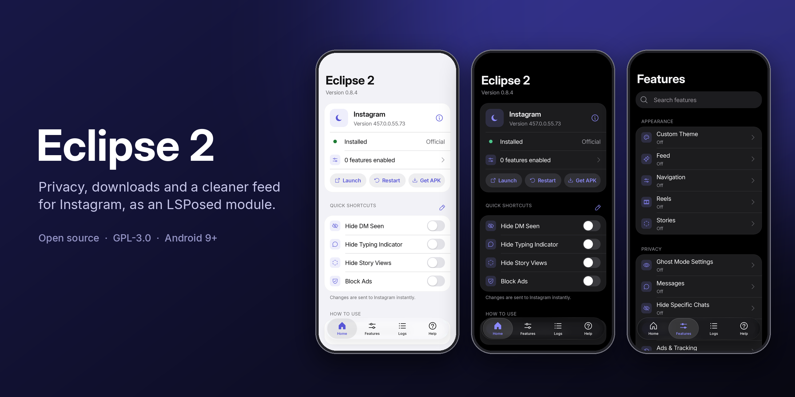
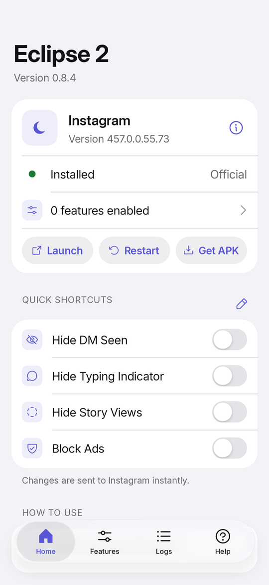
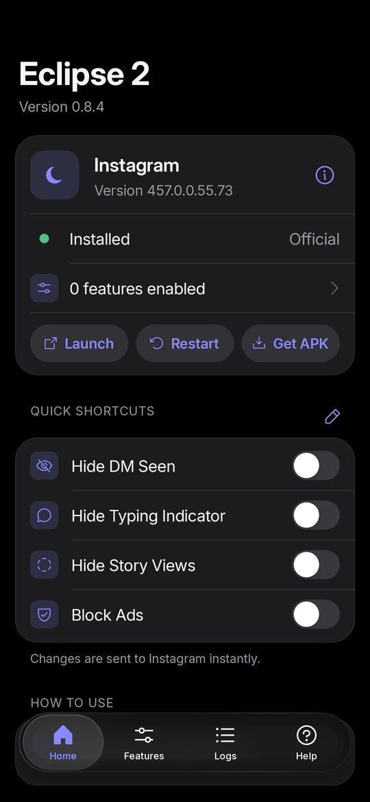
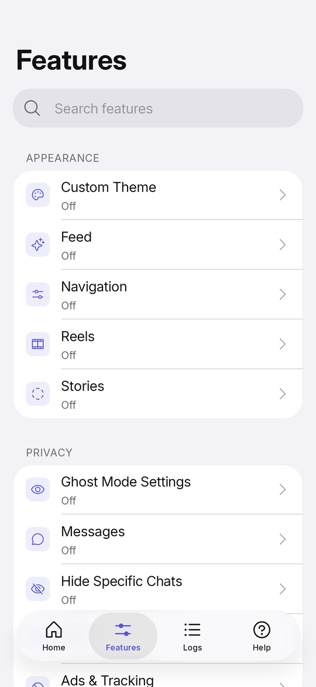
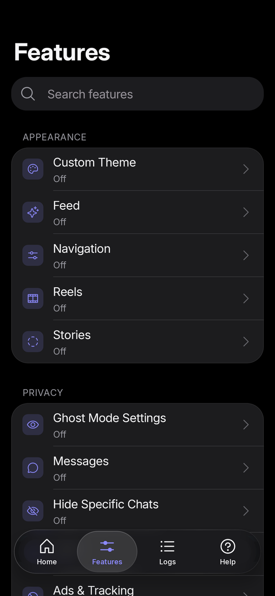
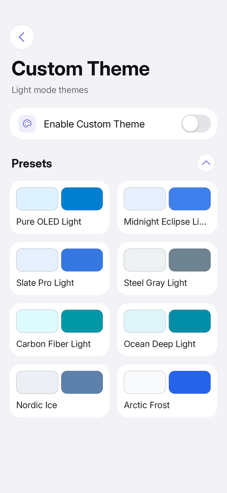
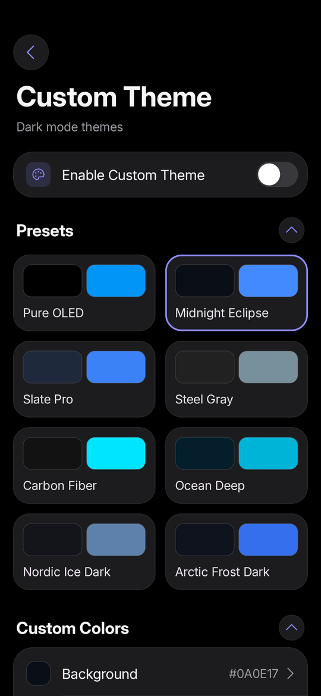
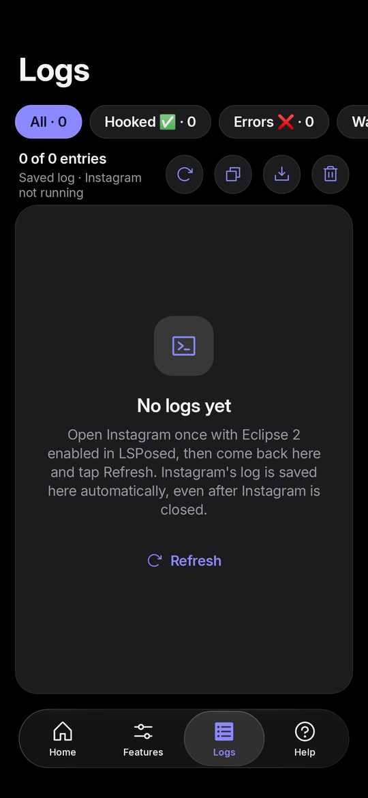
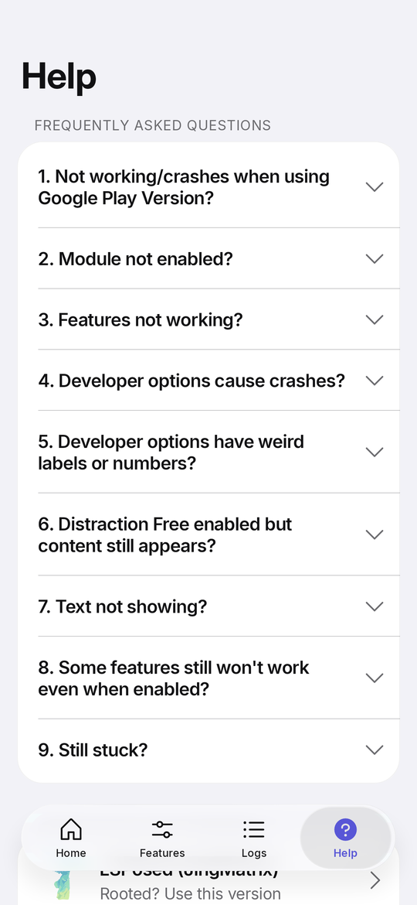

  

  

    
    
    
    
    
  

  

    <a href="#screenshots">Screenshots</a> •
    <a href="#features">Features</a> •
    <a href="#compatibility">Compatibility</a> •
    <a href="#installation">Installation</a> •
    <a href="#using-it">Using it</a> •
    <a href="#faq">FAQ</a> •
    <a href="#license">License</a>
  

---

Eclipse 2 is an LSPosed module for Instagram on Android 9 and newer. It adds privacy switches, media downloads, feed cleanup and theming, all controlled from a menu inside Instagram, and it comes with a companion app for status, logs and settings backup. It runs on rooted phones through LSPosed and on unrooted phones through LSPatch.

**[Download the latest APK](https://github.com/somilkhan/Eclipse-2/releases/latest)**. If Eclipse 2 is useful to you, a star on this repo helps other people find it.

> **Eclipse 2 was called InstaEclipse 2 until version 0.8.4.** It continues [InstaEclipse](https://github.com/Xposed-Modules-Repo/ps.reso.instaeclipse) by [ReSo7200](https://github.com/ReSo7200) and keeps its full history. See [MAINTAINERS.md](MAINTAINERS.md) and [NOTICE](NOTICE).
>
> **Coming from the original InstaEclipse?** Eclipse 2 has its own package name (`io.github.somilkhan.instaeclipse2`), so it installs next to the original. Settings do not carry over: back them up in the old app, restore them here, enable the new module in LSPosed, and re-patch Instagram if you use LSPatch.

## Screenshots

<table>
  <tr>
    <td align="center"> <b>Home</b></td>
    <td align="center"> <b>Home, dark</b></td>
    <td align="center"> <b>Features</b></td>
    <td align="center"> <b>Features, dark</b></td>
  </tr>
  <tr>
    <td align="center"> <b>Themes</b></td>
    <td align="center"> <b>Themes, dark</b></td>
    <td align="center"> <b>Logs</b></td>
    <td align="center"> <b>Help</b></td>
  </tr>
</table>

These images come from the app's own screenshot tests, not from a phone. They use sample data, and the glass blur on a real device is stronger than what the test renderer draws.

> Eclipse 2 is an independent, educational project. Meta and Instagram have nothing to do with it, and it contains no Instagram code or artwork. See the [Disclaimer](DISCLAIMER.md).

---

## How it works

Long press the Explore (search) tab inside Instagram and the Eclipse 2 menu slides up. Flip the switches you want, and most apply right away. The companion app shows whether the module is running, shows its logs, backs up your settings, edits themes and answers common questions.

Eclipse 2 uses [DexKit](https://github.com/LuckyPray/DexKit) to find what it needs inside Instagram each time Instagram updates, instead of relying on class names that change with every build. Most features keep working after an Instagram update without a new module release.

---

## Features

Everything here is a switch in the menu. Tap a section to open it.

<b>👻 Ghost Mode</b>: browse without leaving footprints

 

| Feature | What it does |
|---|---|
| Hide DM seen | Read messages without sending a read receipt |
| Read receipts for specific chats | Keep Hide DM seen on for everyone, but still send "Seen" in the chats you pick (set it from the chat's Eclipse 2 menu) |
| Hide typing indicator | Type without the other person seeing the dots |
| Hide story views | Watch stories without appearing in the viewer list |
| Mark a story as seen | Send the view for one story on purpose, from the story menu |
| Hide live presence | Join lives without being counted |
| Bypass screenshot detection | Screenshot disappearing media without the other person being told |
| Allow screenshots in DMs | Take screenshots where Instagram blocks them |
| Hide view once opened | Open view once media without marking it as opened |
| Unlock view once and view twice | Replay view once media instead of it disappearing |
| Spoof last seen | Freeze your "active" status |
| Airplane mode | Appear offline: Instagram stops its live connection while you browse |
| Ghost icon | Turn Ghost Mode on and off from an icon next to your inbox |

<b>💬 Messages</b>: keep what matters in your chats

 

| Feature | What it does |
|---|---|
| Keep disappearing messages | Stop ephemeral messages from deleting themselves |
| Log unsent messages | When someone unsends a message, keep a private copy, grouped per chat and named after it |
| Edit history | See every earlier version of a message that was edited |
| Chat export | Export a chat to a readable HTML page with replies, reactions, edit history and optional media |
| Jump to first message | Scroll a chat all the way back to its first message |
| Voice message downloads | Save voice messages, named by sender |
| Translate messages | Send a message to your translator app from its long press menu (under More) |
| Unsend multiple messages | Long press one of your messages, then More, Unsend multiple: check your messages right in the chat and unsend them all at once |
| Hide specific chats | Hide chats from your inbox and manage them later |
| Hide the Notes tray | Remove Notes from the top of your inbox |
| Hide Blend in chats | Remove the Blend button from the chat header |
| Hide "Create group" | Remove it from the share sheet |

All chat tools live in one Eclipse 2 button in the chat header, next to the back arrow.

<b>📖 Stories</b>: see everything a story holds

 

| Feature | What it does |
|---|---|
| Story Info | Exact posted, expiry and edit times, music, location, hashtags, reshared from, original post or reel, posting app, alt text, size, countdowns, questions, Add Yours (exact joined count and top people), paid partnership and collaborators. Tap any line to copy it |
| Music links | Open the song in Spotify, YouTube Music or Apple Music, from Story Info, or from Media info on posts and reels |
| Poll, slider and quiz results | Results drawn as bars, your own answer marked, and the correct quiz answer in green |
| Copy story links | Copy the links from link stickers, or pick from a list when there are several |
| View story mentions | See every @mention at once. Tap to copy, hold to open the profile |
| Search your story viewers | A search box over your viewer list |
| Disable story auto swipe | Stories stop advancing on their own |
| Download a whole highlight | From the highlight's long press menu |

<b>🎬 Reels</b>: watch on your terms

 

| Feature | What it does |
|---|---|
| Force Reels quality | Pick a fixed quality (Auto, 360p to 1080p, or Max) |
| Playback speed | 0.5x to 3x for reels, stories and feed videos |
| Hold for slow motion | Hold the left side of a reel for 0.5x, the right side for 2x |
| Always show the seek bar | Scrub through any reel |
| Reels auto scroll | Move to the next reel when one ends |
| Lock Reels scrolling | Stop accidental swipes |
| Disable repost | Keep the repost button from reposting |

<b>📥 Downloads and media</b>: save and share anything

 

| Feature | What it does |
|---|---|
| Download posts, reels and stories | Single photos, full carousels, reels, and stories (your own included, with music) |
| Download profile pictures | Long press a profile picture to see the full-size original, square, and save it |
| Audio only | Save only the audio of a video or reel as .m4a, including a post's music |
| Copy media link | Copy the direct link for a post, reel or a single carousel slide |
| Copy image | Copy a photo straight to the clipboard |
| Media info | Resolution, file size, the song with streaming links, and an option to open the file in another app |
| Download with Eclipse 2 | Share a post or reel link from any app to download it |
| Story cache | Keep stories you watched for 24 hours, so you can save ones that expired |
| Save Instants | Long press an Instant to save it |
| Upload Instant from gallery | Send a picture from your gallery as an Instant |
| Max upload quality | Always upload at the highest quality |
| Download folder | Choose the folder, sort into a folder per account, and add the date to file names |

<b>✨ Feed</b>: see the people you actually follow

 

| Feature | What it does |
|---|---|
| Following only feed | Show only posts from accounts you follow |
| Hide suggestions | Remove suggested posts, reels and accounts |
| Hide Threads suggestions | Drop the Threads promos |
| Hide posts you already liked | Skip what you have seen |
| Hide community notes | Remove notes added under posts and reels |
| Hide Instagram Plus upsells | No more Plus prompts |
| Hide the story tray | Keep the feed, lose the story row |
| Disable Discover People | Remove the "people you may know" row |
| Always show full captions | No more "... more" |
| Exact dates | "17 Oct 2026 07:36" instead of "2h ago", in the date format you pick (presets or your own pattern) |
| High resolution images | Load the sharpest version of every photo |
| Photo zoom | Long press a photo to zoom in |
| Disable video autoplay | Videos wait for a tap |

<b>❤️ Likes, comments and profiles</b>

 

| Feature | What it does |
|---|---|
| Disable double tap to like | No accidental likes, in posts, comments and DMs |
| Undo a like | A few seconds to take a like back |
| Comment search | Search a post's comments, load them all, and export them |
| Copy comments and captions | Copy any comment, or a caption with or without hashtags |
| Translate | Translate captions, comments and chat messages with your own translator app |
| Save comment GIFs and images | Download the media in comments |
| "Follows you" label | See on any profile whether they follow you back |
| Follower toast | A short message when you open a profile |
| Export followers and following | Save the whole list as CSV |
| Followers history | See who unfollowed you and who followed you since your last check |
| Saved on your profile | A Saved button right on your profile |
| Lock Saved collections | Put a passcode on a collection |
| Hide the Threads button | Remove it from profiles |

<b>🧭 Navigation</b>: arrange Instagram's tabs

 

| Feature | What it does |
|---|---|
| Hide tabs | Hide Home, Reels, Create, Messages, Activity or Profile |
| Tab order | Put the bottom tabs in any order |
| Startup tab | Choose which tab Instagram opens on |
| Disable swipe to camera | Stop the camera from opening on a swipe |

<b>🔒 Privacy and security</b>

 

| Feature | What it does |
|---|---|
| Lock the whole app | Passcode or fingerprint to open Instagram |
| Lock DMs | Lock only the inbox, and optionally lock it again every time you leave |
| Block ads and analytics | Drop sponsored posts and tracking calls |
| Disable tracking links | Strip only the tracking parts from links you share |
| Open links externally | Use your own browser instead of Instagram's |
| Custom share domain | Share links with a different domain |
| Remove Meta AI | Take Meta AI out of search, chats and reels |
| Hide onboarding prompts | Skip the nag screens |
| Location spoofing | Pick any place on a map; Instagram sees that location everywhere |

<b>🎨 Appearance</b>: make it yours

 

| Feature | What it does |
|---|---|
| Custom theme | Presets or your own colors for every part of the app, applied live |
| Light and dark themes | Every theme has both versions and follows your phone |
| Themed menus | Eclipse 2's own menus, toggles and dialogs use your theme's accent color |
| Custom font | Use any .ttf or .otf across the app |
| Custom emoji | Swap in another emoji font |

<b>🧘 Distraction Free</b>: quiet the parts that pull you in

 

| Feature | What it does |
|---|---|
| Turn off sections | Stories, Feed, Reels (or all Reels except in DMs), Explore and Comments, one by one |
| Extreme mode | Lock those choices in until you reinstall |

<b>🛠️ Tools and developer options</b>

 

| Feature | What it does |
|---|---|
| Developer Options | Instagram's hidden internal panel, with config import, export and a known good default |
| Unlimited accounts | Add more accounts than Instagram allows |
| Notification fix | Repair notifications that stopped arriving |
| Auto clear cache | Clear Instagram's media cache once it gets too big |
| Backup and restore | All settings to a file and back |
| Feature toasts | See which features loaded when Instagram starts |

<b>📱 Companion app</b>

 

| Feature | What it does |
|---|---|
| Home dashboard | Module status, Instagram version, launch and restart buttons, and your pinned shortcuts |
| Feature search | Find any switch by name |
| Live logs | Hook status from Instagram and the app, no adb needed |
| Help | Frequently asked questions, setup links for LSPosed and LSPatch, and the community |
| 18 languages | English, Arabic, Azerbaijani, Chinese (Simplified and Traditional), French, German, Greek, Hebrew, Indonesian, Italian, Polish, Portuguese, Russian, Spanish, Swedish, Turkish and Vietnamese |

---

## Compatibility

| | |
|---|---|
| **Tested on** | Instagram `457.0.0.55.73` |
| **Get this version** | [Instagram 457.0.0.55.73 on APKMirror](https://www.apkmirror.com/apk/instagram/instagram-instagram/instagram-457-0-0-55-73-release/) |
| **Survives updates** | Yes, DexKit finds what it needs at runtime |
| **Android** | 9 and newer |

A big Instagram update can still knock a feature out until it is patched. The menu inside Instagram shows how many features are active (for example "62/62 active"); tap it to see which ones could not attach. If something breaks right after an update, check the [Telegram channel](https://t.me/InstaEclipse) first.

---

## Installation

> Get Instagram [457.0.0.55.73 from APKMirror](https://www.apkmirror.com/apk/instagram/instagram-instagram/instagram-457-0-0-55-73-release/) rather than the Play Store. The Play build is not always fully supported.

Download the latest Eclipse 2 APK from [**Releases**](https://github.com/somilkhan/Eclipse-2/releases/latest), then follow the path for your phone.

### Rooted, with LSPosed

> Needs [JingMatrix's LSPosed](https://github.com/JingMatrix/LSPosed/releases/latest).

1. **Install Eclipse 2** from the APK you downloaded.
2. **Enable the module.** In LSPosed Manager, open Modules, enable Eclipse 2 and tick Instagram.
3. **Restart Instagram.** Force stop it and open it again.
4. **Open the menu.** Long press the Explore (search) tab.

> [!CAUTION]
> Using Hide My Applist? Do not hide Eclipse 2 from Instagram. Instagram needs to see it, or the menu text goes missing and features stop working.

### No root, with LSPatch

> Needs [JingMatrix's LSPatch](https://github.com/JingMatrix/LSPatch/releases/latest).

1. **Install Eclipse 2** from the APK.
2. **Install LSPatch** (the JingMatrix fork).
3. **Patch Instagram.** In LSPatch, tap **+**, pick the Instagram APK or the installed app, choose **Local Patch Mode**, turn on **Inject loader dex**, then tap **Start Patch**.
4. **Install the patched APK** and log in.
5. **Enable the module.** In LSPatch, open Manage, pick Instagram, open Modules and enable Eclipse 2.
6. **Open the menu.** Long press the Explore (search) tab.

There is also a [step by step guide](https://t.me/instaEclipse_discussion/158/5149) in the community.

---

## Using it

- **Open the menu:** long press the Explore (search) tab inside Instagram.
- **Find things:** sections are grouped into Appearance, Privacy, Media, Social and Tools. Each shows how many of its switches are on.
- **Chat tools:** open any chat and tap the Eclipse 2 button next to the back arrow.
- **Story tools:** open a story and tap its ⋯ menu for Story Info, links, mentions and results.
- **Back:** the phone's back button steps back one page at a time.

Updates and tips:

- 📢 Announcements: [Telegram channel](https://t.me/InstaEclipse)
- 💬 Questions and help: [Telegram group](https://t.me/instaEclipse_discussion)

---

## FAQ

**A feature is not doing anything.**
Disable and enable the module again in LSPosed or LSPatch, then force stop and reopen Instagram.

**The text in the Eclipse 2 menus is missing.**
Turn off Hide My Applist (HMA) for Instagram. Eclipse 2 reads its text from its own app, and HMA hides it.

**Some features will not work even when they are on.**
Instagram's own config can block them. Open Developer Options and choose Restore Default Config. The same config is also on [Telegram](https://t.me/InstaEclipse/52).

**Developer Options labels show up as numbers.**
That happens on Instagram's Stable build. Use a Beta or Alpha build from APKMirror.

**I turned on Distraction Free but the content is still there.**
Force stop Instagram and clear its cache, then open it again.

**It does not work on the Play Store version.**
Install [Instagram 457.0.0.55.73 from APKMirror](https://www.apkmirror.com/apk/instagram/instagram-instagram/instagram-457-0-0-55-73-release/) instead.

**Still stuck?**
Ask in the [Telegram group](https://t.me/instaEclipse_discussion). Someone will help.

---

## Contributors

### Original author

<a href="https://github.com/ReSo7200">
   
  <b>ReSo7200</b>
</a>

Created InstaEclipse and led it through 0.8.x.

  

### Maintainer

<a href="https://github.com/somilkhan">
   
  <b>somilkhan</b>
</a>

Maintains this continuation.

  

### Everyone who has pitched in

Made with <a href="https://contrib.rocks">contrib.rocks</a>

 

**Thank you** to [b4lol](https://github.com/b4lol) for the extras, security and performance work in this release, to [izadiegizabal](https://github.com/izadiegizabal) for own story downloads, and to everyone who translated the app into their language.

---

## Built with

- [JingMatrix/LSPosed](https://github.com/JingMatrix/LSPosed), the Xposed framework it runs on
- [JingMatrix/LSPatch](https://github.com/JingMatrix/LSPatch), for phones without root
- [LuckyPray/DexKit](https://github.com/LuckyPray/DexKit), which finds Instagram's code at runtime

---

## Contributing

Pull requests, bug reports, ideas and translations are all welcome.

- Found a bug? [Open a bug report](https://github.com/somilkhan/Eclipse-2/issues/new/choose)
- Have an idea? [Request a feature](https://github.com/somilkhan/Eclipse-2/issues/new/choose)
- Want to build something? Fork the repo and open a pull request. Start with [CONTRIBUTING.md](CONTRIBUTING.md).
- Maintainers: see [MAINTAINERS.md](MAINTAINERS.md) and [RELEASING.md](RELEASING.md).

---

## License

Eclipse 2 is free software under the [GNU General Public License v3.0](LICENSE). You can use, study, change and share it, and anyone you share it with gets the same rights. If you distribute a modified build, you must publish its source under the GPL as well.

The project reuses GPL-3.0 code from HushGram, so the whole work, APK included, has to be GPL-3.0. The original InstaEclipse code by ReSo7200 was Apache-2.0, which the GPL allows. Its notices and license text are kept in [LICENSES/Apache-2.0.txt](LICENSES/Apache-2.0.txt), and [NOTICE](NOTICE) lists every third-party component and its license.

---

  Made by the Eclipse 2 community. 
  Not affiliated with Meta or Instagram. Released under <a href="LICENSE">GPL-3.0</a>. See the <a href="DISCLAIMER.md">Disclaimer</a>.

